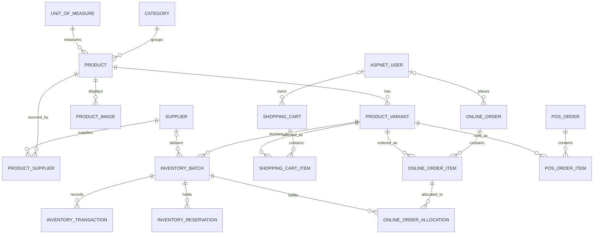

# 🛒 Tạp hóa Chị Tỏ (Website-Omnichannel)


Hệ thống quản lý bán hàng Omnichannel toàn diện dành cho cửa hàng tạp hóa, tích hợp 3 phân hệ chính: **Website bán hàng E-Commerce**, **Phân hệ bán quầy POS**, và **Hệ thống Quản trị & Vận hành (Store Management)**.

## Xem bản demo trực tuyến

**[Mở website Omnichannel](https://website-omnichannel.pages.dev/)**

**[Đăng nhập bản demo dành cho nhà tuyển dụng](https://website-omnichannel.pages.dev/demo)**

| Tài khoản demo | Thông tin đăng nhập |
| --- | --- |
| Email | `demo@omnichannel.example` |
| Mật khẩu | `OmnichannelDemo2026!` |

Sau khi đăng nhập, bạn có thể tìm sản phẩm, thêm vào giỏ và đặt một đơn mẫu. Giỏ hàng và đơn thử chỉ tồn tại trong tab hiện tại. Để thử các vai trò nhân viên bán hàng, quản lý và quản trị viên, chạy dự án với database test theo hướng dẫn bên dưới.

## Phạm vi MVP

MVP phục vụ một cửa hàng tạp hóa bán trên website và tại quầy, dùng chung danh mục sản phẩm và tồn kho theo lô.

| Vai trò | Luồng trong MVP | Kết quả cần đạt |
| --- | --- | --- |
| Khách và `Buyer` | Tìm sản phẩm, quản lý giỏ, đặt hàng COD và theo dõi đơn. Người đã đăng nhập xem được lịch sử đơn của tài khoản. | Đơn lưu các dòng hàng, trạng thái và chủ sở hữu. Khách chỉ xem được đơn của phiên mình. |
| `Seller` | Tìm sản phẩm theo tên, SKU hoặc mã vạch, thanh toán tại quầy và ghi nhận hóa đơn. | Đơn POS tính tiền thanh toán và cập nhật tồn kho theo lô. |
| `Manager` | Quản lý danh mục, biến thể, nhà cung cấp, nhập kho, xem tồn thấp và xử lý đơn online. | Website và POS sử dụng cùng dữ liệu sản phẩm và tồn kho. Thao tác quản lý yêu cầu đúng vai trò. |
| `Admin` | Quản lý người dùng, vai trò và quyền truy cập. | API từ chối thao tác quản trị nếu người gọi thiếu quyền. |

### Ngoài phạm vi MVP

- Quản lý nhiều chi nhánh, chuyển kho liên chi nhánh và đồng bộ với sàn thương mại điện tử bên ngoài.
- Cổng thanh toán trực tuyến, xử lý thẻ, đối soát ngân hàng tự động và tạo vận đơn qua hãng vận chuyển.
- Ứng dụng iOS/Android riêng và POS hoạt động offline rồi đồng bộ.
- Khuyến mãi nâng cao, đánh giá, đổi trả, báo cáo doanh thu và in nhãn giá là các chức năng mở rộng. Luồng MVP có thể chạy độc lập với chúng.

---

## 🌟 Chức năng nổi bật

### 1. 🛍️ Khách hàng (E-Commerce Storefront)
- **Duyệt & Tìm kiếm**: Xem danh mục sản phẩm, biến thể, lọc theo giá/danh mục, tìm kiếm nhanh.
- **Khuyến mãi**: Hiển thị tự động các chương trình giảm giá/ưu đãi còn hiệu lực.
- **Giỏ hàng & Checkout**: Hỗ trợ giỏ hàng khách vô danh (Guest) và đồng bộ khi đăng nhập (Member), đặt hàng trực tuyến.
- **Vận chuyển & Phí giao hàng**: Tích hợp Goong Maps API tính khoảng cách thực tế và chi phí giao hàng theo địa chỉ.
- **Theo dõi đơn hàng**: Cập nhật trạng thái đơn hàng thời gian thực (Chờ xác nhận ➔ Đang chuẩn bị ➔ Đang giao ➔ Hoàn tất).
- **Tài khoản cá nhân**: Quản lý hồ sơ, sổ địa chỉ nhận hàng, lịch sử đơn hàng, đánh giá sản phẩm, đổi mật khẩu.

### 2. 🖥️ Nhân viên quầy (Seller / POS - Point of Sale)
- **Giao diện POS tối ưu**: Tối ưu thao tác màn hình cảm ứng & phím tắt, tìm kiếm sản phẩm / quét mã vạch siêu nhanh.
- **Tạo hóa đơn & Thanh toán**: Xử lý đơn tại quầy, tính tiền thừa, áp dụng mã giảm giá.
- **In ấn chuyên nghiệp**:
  - In hóa đơn nhiệt khổ 58mm tức thì.
  - In nhãn giá (Price Tags) hàng loạt khổ 60 × 40 mm dàn trang chuẩn A4.

### 3. ⚙️ Quản lý & Vận hành (Manager / Admin Dashboard)
- **Quản lý Catalogue**: Thêm/sửa danh mục, sản phẩm, biến thể, đơn vị tính (Unit), hình ảnh sản phẩm.
- **Quản lý Tồn kho & Nhà cung cấp**: Nhập kho theo lô (Batch), quản lý hạn sử dụng, nhà cung cấp (Suppliers), cảnh báo tồn kho sắp hết/hết hạn.
- **Quản lý Khuyến mãi**: Thiết lập chương trình giảm giá theo khoảng thời gian hoặc theo dòng sản phẩm.
- **Quản lý Xử lý Đơn hàng**: Tiếp nhận đơn online, duyệt báo giá giao hàng, điều phối giao hàng và hoàn tất.
- **Quản lý Trả hàng (Returns)**: Xử lý quy trình đổi trả hàng từ khách.
- **Báo cáo & Audit Logs**: Thống kê doanh thu, lịch sử thao tác hệ thống (Audit Logs) đảm bảo tính minh bạch.
- **Cấu hình Cửa hàng**: Thiết lập thông tin cửa hàng, phí giao hàng cơ sở, tham số hệ thống.

### 4. 🔐 Xác thực & Phân quyền (Auth & Security)
- **Xác thực JWT**: Bảo mật API với JSON Web Token, phân quyền theo vai trò (Customer, Seller, Manager/Admin).
- **Đăng ký & Kích hoạt**: Đăng ký qua Email/SMS, xác minh liên kết 1 lần.
- **Tài khoản Nhân viên**: Quản lý tạo tài khoản nhân viên (Pending activation ➔ Đặt mật khẩu lần đầu để kích hoạt).
- **Quên / Đặt lại mật khẩu**: Gửi email reset password với token dùng 1 lần (SMTP Gmail/Provider).

---

## 🏗️ Kiến trúc Hệ thống

### Mô hình tổng quan

```text
               ┌──────────────────────────────────────────────┐
               │    Frontend UI (React 19 + TypeScript)       │
               │   • E-Commerce Store  • POS  • Admin Dash   │
               └──────────────────────┬───────────────────────┘
                                      │  HTTPS / REST JSON
                                      ▼
               ┌──────────────────────────────────────────────┐
               │          ASP.NET Core 10 Web API             │
               │     (Clean Architecture / RESTful APIs)      │
               └──────┬───────────────┬───────────────┬───────┘
                      │               │               │
                      ▼               ▼               ▼
               ┌────────────┐   ┌────────────┐   ┌────────────┐
               │ SQL Server │   │ SMTP Mail  │   │ Goong Maps │
               │ (EF Core)  │   │ / Services │   │   (Geoc)   │
               └────────────┘   └────────────┘   └────────────┘
```

### Cấu trúc Thư mục

Backend tuân thủ nghiêm ngặt nguyên lý **Clean Architecture**:

```text
webShop/
├── backend/                              # .NET 10 Solution
│   ├── src/
│   │   ├── GroceryStore.Api/             # Controllers, Middlewares, Dependency Injection, Swagger
│   │   ├── GroceryStore.Application/     # Use Cases, DTOs, Commands/Queries, Interface Contracts
│   │   ├── GroceryStore.Domain/          # Core Business Entities, Enums, Value Objects, Domain Rules
│   │   ├── GroceryStore.Infrastructure/  # External Services (SMTP Email, Goong Maps, Image Storage)
│   │   └── GroceryStore.Persistence/     # EF Core DbContext, Migrations, Repositories, Configurations
│   └── tests/
│       ├── GroceryStore.UnitTests/       # Unit tests cho Domain & Application logic
│       ├── GroceryStore.IntegrationTests/# Integration tests cho API & Persistence
│       └── GroceryStore.ArchitectureTests/# Test kiểm tra ràng buộc kiến trúc Clean Architecture
├── frontend/                             # React 19 + TypeScript + Vite SPA
│   ├── src/
│   │   ├── app/                          # App Providers, Router, CSS Tokens & Global Styles
│   │   ├── features/                     # Functional Modules (auth, catalog, cart, checkout, pos, admin, etc.)
│   │   ├── layouts/                      # Layouts (Public, Admin, Seller POS)
│   │   └── shared/                       # Shared UI components, hooks, utilities, API clients
├── database/                             # Script database seed & schema initialization
├── deploy/                               # Mẫu cấu hình deployment (Render, Docker, Cloudflare)
└── project-documents/                    # Sơ đồ kiến trúc và dữ liệu (PNG)
```

## Mô hình dữ liệu

SQL Server lưu dữ liệu qua EF Core. Sơ đồ dưới đây rút gọn các quan hệ của luồng MVP. Tệp [ApplicationDbContext](backend/src/GroceryStore.Persistence/Context/ApplicationDbContext.cs) và [migrations](backend/src/GroceryStore.Persistence/Migrations) mô tả khóa, chỉ mục và ràng buộc vật lý.



| Nhóm | Bảng chính và quy tắc |
| --- | --- |
| Định danh | `AspNetUsers`, `AspNetRoles`, `AspNetUserRoles`, `RefreshSessions`. Đơn online và giỏ hàng có thể thuộc tài khoản hoặc phiên khách. |
| Danh mục | `Products` dùng `CategoryId` và `UnitOfMeasureId`. `ProductVariants` có khóa chính `ProductVariantId` và khóa ngoại `ProductId`. SKU và mã vạch có giá trị phải duy nhất. `ProductImages` gắn với sản phẩm. |
| Kho | `ProductSuppliers` nối sản phẩm với nhà cung cấp bằng khóa ghép `(ProductId, SupplierId)`. `InventoryBatches` có khóa chính `InventoryBatchId`, lưu số lượng và hạn sử dụng theo `ProductVariantId`. `InventoryTransactions` ghi biến động và `InventoryReservations` giữ hàng có thời hạn. |
| Bán hàng | `ShoppingCartItems` nối giỏ với biến thể. `OnlineOrderItems` thuộc `OnlineOrders` qua `OnlineOrderId`. `OnlineOrderAllocations` nối `OnlineOrderItemId` với `InventoryBatchId`. POS dùng `Orders` và `OrderItems`, nối bằng `OrderId`. |
| Sau bán và cấu hình | `ProductReviews` và `ReturnRequests` tham chiếu dòng đơn online. `StoreSettings` và `StoreContactNumbers` lưu thông tin cửa hàng. |

[ERD tổng quan](project-documents/erd_overview.png) · [ERD danh mục và kho](project-documents/erd_catalog_inventory.png) · [ERD bán hàng và đổi trả](project-documents/erd_sales_returns.png)

## Danh sách API endpoint

Base URL local là `http://localhost:5261`. Nối tiền tố với đường dẫn con trong bảng để lấy URL đầy đủ. Với endpoint có phân quyền, gửi `Authorization: Bearer <access-token>`. Các thao tác giỏ của khách dùng `X-Guest-Cart-Token` hoặc `X-Cart-Session`. API đơn online dùng `X-Cart-Session` ở các thao tác gắn với giỏ hoặc chủ đơn.

| Nhóm và tiền tố | Endpoint | Quyền |
| --- | --- | --- |
| Vận hành | `GET /health`, `GET /health/ready` | Công khai |
| Danh mục `/api` | `GET /categories`, `GET /units-of-measure`, `GET /products`, `GET /products/{productId}`, `GET /products/by-slug/{slug}`, `GET /product-images/{productImageId}` | Công khai |
| Xác thực `/api/auth` | `POST /register`, `POST /login`, `POST /refresh`, `POST /logout`, `POST /confirm-email`, `POST /confirm-phone`, `POST /password-resets`, `POST /password-resets/confirm` | Theo thông tin đăng nhập, token hoặc mã của từng endpoint |
| Hồ sơ `/api/account` | `GET /profile`, `PUT /profile`, `POST /change-password`, `POST /contact-changes`, `POST /contact-changes/confirm`, `GET /orders` | Đã đăng nhập |
| Giỏ `/api/cart` | `GET` ở tiền tố, `PUT /items`, `DELETE /items/{productVariantId}`, `POST /reservations`, `POST /merge` | Phiên khách hoặc chủ giỏ. `/merge` yêu cầu đăng nhập. |
| Đơn online `/api/online-orders` | `POST /checkout`, `GET /{onlineOrderId}`, `POST /{onlineOrderId}/cancel`, `POST /{onlineOrderId}/accept-quote`, `GET /mine` | Phiên khách hoặc tài khoản sở hữu đơn. `/mine` yêu cầu đăng nhập. `Admin` và `Manager` có thể xem chi tiết. |
| Vận hành đơn `/api/online-orders` | `GET` ở tiền tố. Với `/{onlineOrderId}`, thêm `PUT /shipping-quote` hoặc `POST` cho `/confirm-cod-payment`, `/preparing`, `/delivering`, `/delivered`, `/delivery-failed`, `/returned`. | `Admin`, `Manager` |
| Danh mục quản trị `/api/admin/catalog` | `GET` và `POST /categories`, `PUT` và `DELETE /categories/{categoryId}`<br>`GET` và `POST /units-of-measure`, `PUT` và `DELETE /units-of-measure/{unitOfMeasureId}`<br>`GET` và `POST /products`, `GET`, `PUT` và `DELETE /products/{productId}` | `Admin`, `Manager` |
| Biến thể và ảnh `/api/admin/catalog/products/{productId}` | `POST /variants`, `PUT` và `DELETE /variants/{productVariantId}`, `POST /images`, `DELETE /images/{productImageId}` | `Admin`, `Manager` |
| Kho `/api/admin/inventory` | `GET` và `POST /suppliers`, `PUT` và `DELETE /suppliers/{supplierId}`, `POST /product-suppliers`<br>`GET /batches`, `GET /low-stock`, `GET /variants/{productVariantId}/stats`, `POST /receipts`, `POST /batches/{inventoryBatchId}/adjustments` | `Admin`, `Manager` |
| POS `/api/admin/pos` | `GET /products`, `POST /checkout` | `Admin`, `Manager`, `Seller` |
| Đánh giá `/api/reviews` | `POST` ở tiền tố, `PUT /{reviewId}/reply`, `POST /{reviewId}/hide` | `Buyer` tạo. `Admin` hoặc `Manager` phản hồi hoặc ẩn. |
| Đổi trả `/api/return-requests` | `POST` ở tiền tố, `PUT /{returnRequestId}/resolve` | `Buyer` gửi yêu cầu. `Admin` hoặc `Manager` xử lý. |
| Cấu hình và báo cáo | `GET /api/store-settings/public`, `GET` và `PUT /api/store-settings`, `GET /api/admin/reports` | Đường dẫn `/public` công khai. Các đường dẫn còn lại yêu cầu `Admin` hoặc `Manager`. |
| Người dùng và kiểm toán | `GET` và `POST /api/users`, `DELETE /api/users/{userId}`, `PUT /api/users/{userId}/activation`, `PUT /api/users/{userId}/role`, `GET /api/audit-logs` | `Admin` |

`GET /api/products` nhận `search`, `categoryId`, `page` và `pageSize`. Mở [Swagger UI](http://localhost:5261/swagger) hoặc [OpenAPI JSON](http://localhost:5261/swagger/v1/swagger.json) khi API chạy ở môi trường Development để xem schema yêu cầu và phản hồi. Các đường dẫn trong bảng được đối chiếu với [controller ASP.NET Core](backend/src/GroceryStore.Api/Controllers).

Khi chạy Angular qua [Cloudflare Worker](angular-client/worker/index.mjs), `GET /api/session` lấy trạng thái phiên và `DELETE /api/session` xóa cookie đăng nhập. Hai endpoint này được Worker xử lý.

---

## 🛠️ Môi trường & Yêu cầu Hệ thống

- **.NET SDK**: 10.0+
- **Node.js**: 22.12+ & **npm**: 10+
- **Database**: SQL Server (SQL Express, LocalDB, Docker SQL Server hoặc Azure SQL)
- **Dịch vụ tích hợp (Tùy chọn cho Dev)**:
  - Tài khoản **Goong Maps API Key** (dùng để tính khoảng cách và phí ship).
  - Gmail App Password hoặc SMTP Server (dùng để gửi Email xác minh/quên mật khẩu).

---

## 🚀 Hướng dẫn Chạy Local (Development)

### Bước 1. Cấu hình database test và biến môi trường

Trong PowerShell tại thư mục gốc, sao chép `.env.example` thành `.env.local` nếu chưa có file này.

```powershell
if (-not (Test-Path .env.local)) { Copy-Item .env.example .env.local }
```

Mẫu `.env.example` dùng database SQL Server cục bộ **`WebsiteOmnichannelDemo`** và gửi email mô phỏng. Nếu dùng SQL Server Express hoặc instance khác, thay `Server=localhost` bằng tên instance của bạn. Đặt `Jwt__Key` riêng dài ít nhất 32 ký tự. Nếu muốn thử đăng nhập theo vai trò, đặt mật khẩu riêng cho từng `DemoIdentity__Accounts__*__Password` trong `.env.local`. Dùng các tài khoản mẫu này trong database test trên máy của bạn.

### Bước 2. Tạo schema và nạp dữ liệu mẫu

Đặt biến môi trường cho EF Core bằng cùng chuỗi kết nối database test trong `.env.local`, rồi chạy migration trước khi seed. Các lệnh dưới đây dùng SQL Server local và xác thực Windows.

```powershell
$env:ConnectionStrings__DefaultConnection = 'Server=localhost;Database=WebsiteOmnichannelDemo;Trusted_Connection=True;TrustServerCertificate=True;Encrypt=False'
dotnet tool restore
dotnet tool run dotnet-ef database update --project backend/src/GroceryStore.Persistence --startup-project backend/src/GroceryStore.Api

dotnet run --project backend/src/GroceryStore.Api -- --seed-demo-catalog
dotnet run --project backend/src/GroceryStore.Api -- --seed-demo-images
dotnet run --project backend/src/GroceryStore.Api -- --verify-demo-catalog
```

Nếu cần thử các màn hình theo vai trò, chạy thêm `dotnet run --project backend/src/GroceryStore.Api -- --seed-demo-identities` sau khi đặt mật khẩu trong `.env.local`.

### Bước 3. Khởi chạy API

```powershell
dotnet run --project backend/src/GroceryStore.Api
```

Mở [Swagger](http://localhost:5261/swagger) để xem API hoặc [kiểm tra kết nối database](http://localhost:5261/health/ready).

### Bước 4. Khởi chạy giao diện

Để chạy giao diện React như bản demo trực tuyến, mở một terminal khác.

```powershell
cd frontend
npm ci
npm run dev
```

Mở [giao diện React](http://localhost:5173). Nếu muốn thử Angular, chạy `npm ci` và `npm start` trong `angular-client` rồi mở [giao diện Angular](http://localhost:4200).

### Kiểm chứng API kết nối SQL Server thật

Ngày **21/11/2026**, smoke test chạy trên Windows với .NET SDK `10.0.404` và SQL Server 2022 Developer `16.0.4215.2` trong Docker. EF Core áp dụng **13 migrations** vào database test mới `OmnichannelApiSmoke` rồi nạp dữ liệu mẫu. ASP.NET Core chạy ở `http://127.0.0.1:5262`.

| Kiểm tra | Kết quả thực tế |
| --- | --- |
| `GET /health/ready` | `200 Healthy` |
| `GET /api/categories` | `200`, trả về 5 danh mục |
| `GET /api/products?page=1&pageSize=3` | `200`, `totalCount=29` và 3 sản phẩm ở trang đầu |
| `GET /api/products/by-slug/banh-oreo-vani-133g` | `200`, trả về đúng slug đã seed |
| Đối chiếu qua `sqlcmd` | `__EFMigrationsHistory`: 13, `Categories`: 5, `Products`: 29 |

Để tái lập với SQL Server trên máy, chạy từ thư mục gốc và thay tên instance nếu cần.

```powershell
$env:ConnectionStrings__DefaultConnection = 'Server=localhost;Database=OmnichannelApiSmoke;Trusted_Connection=True;TrustServerCertificate=True;Encrypt=False'
./scripts/Test-ApiSqlServer.ps1
```

[Script kiểm chứng](scripts/Test-ApiSqlServer.ps1) tự áp migration, seed danh mục, khởi chạy API, kiểm tra HTTP và dừng API khi hoàn tất. Job `sql-smoke` trong [GitHub Actions](https://github.com/PiupiuTenshi/Website-Omnichannel/actions/workflows/backend-ci.yml) chạy cùng script với một container SQL Server riêng. [Hướng dẫn chạy SQL Server bằng Docker](https://learn.microsoft.com/sql/linux/quickstart-install-connect-docker)

---

## 🧪 Chạy Kiểm thử (Testing & Quality Assurance)

### Kiểm thử Backend (.NET Solution)
```powershell
# Kiểm thử toàn bộ Unit Tests, Integration Tests & Architecture Tests
dotnet test backend/GroceryStore.sln

# Build kiểm tra Backend
dotnet build backend/GroceryStore.sln --no-restore
```

### Kiểm thử Frontend (React App)
```powershell
cd frontend

# Chạy Unit / Component tests với Vitest
npm test

# Kiểm tra TypeScript typecheck
npm run typecheck

# Kiểm tra Linter rules
npm run lint

# Build thử sản phẩm production
npm run build
```

---

## 📧 Cấu hình Gửi Email (SMTP)

Để tính năng gửi Email xác minh tài khoản & quên mật khẩu hoạt động thật, cấu hình trong `.env.local`:

```env
Smtp__Provider=Smtp
Smtp__Host=smtp.gmail.com
Smtp__Port=587
Smtp__UserName=your-email@gmail.com
Smtp__Password=your-gmail-app-password
Smtp__FromEmail=your-email@gmail.com
Smtp__FromName=Tap hoa Chi To
```

*Lưu ý:* Khi phát triển local, nếu để `Smtp__Provider=Mock`, hệ thống sẽ ghi nội dung email ra Console log thay vì gửi thật.

---

## 🌐 Hướng dẫn Deployment (Production)

### 1. Backend Web API (Render / Docker)
Repository đã có sẵn `Dockerfile` ở thư mục gốc:
1. Tạo một **Web Service** mới trên Render từ Repository này (chọn Docker build).
2. Thiết lập Environment Variables theo mẫu `deploy/render.env.example`.
3. Dùng `/health` để kiểm tra tiến trình và `/health/ready` để kiểm tra kết nối cơ sở dữ liệu. `/health/ready` trả `503` khi kết nối thất bại.
4. Nếu lưu ảnh bằng filesystem, sao lưu ảnh hiện có trước khi đổi `ImageStorage__LocalRootPath`. Gắn ổ đĩa lưu trữ vào `/var/data`, chép ảnh cũ sang `/var/data/product-images`, rồi kiểm tra cả ảnh cũ và ảnh mới sau khi triển khai.

### 2. Frontend Angular (Cloudflare Workers)

Tên Worker là `omnichannel`. Wrangler in ra địa chỉ theo dạng `omnichannel.<subdomain-tài-khoản>.workers.dev` sau khi triển khai.

Từ thư mục gốc của repo, chạy các lệnh sau với Node.js 22.12 trở lên và tài khoản Cloudflare đã đăng nhập Wrangler.

```sh
cd angular-client
npm ci
npm run build:worker
npx wrangler deploy --dry-run
npx wrangler deploy
```

Worker phục vụ Angular SPA và chuyển `/api/*`, `/health` tới API ASP.NET Core chạy trên Render. Đổi `vars.API_ORIGIN` trong `angular-client/wrangler.jsonc` nếu dùng môi trường API khác. Bản `build:worker` dùng đường dẫn tương đối `/api`, vì vậy trình duyệt gọi cùng origin với SPA và không cần thêm domain Worker vào CORS của API.

Khi triển khai backend đã cập nhật, thêm origin chính xác của Worker vào `Auth__PasswordResetAllowedOrigins__0` trên Render để API chấp nhận yêu cầu gửi liên kết đặt lại mật khẩu. Kiểm tra SMTP bằng tài khoản thử. Backend hiện chỉ có nhà cung cấp SMS mô phỏng, nên xác minh qua email là kênh dùng cho bản Angular production.

### 3. Frontend React (Cloudflare Pages)
1. Thêm Web Project trên Cloudflare Pages liên kết với nhánh `main`.
2. Build Settings:
   - **Framework Preset**: Vite / None
   - **Build command**: `cd frontend && npm ci && npm run build`
   - **Output directory**: `frontend/dist`
   - **Environment Variable (Build-time)**: `VITE_API_BASE_URL=https://<your-api-domain>/api`
3. Sau khi deploy xong, nhớ cập nhật biến `Cors__AllowedOrigins__0` trên Render Backend khớp với URL domain của Cloudflare Pages.

---

## 🛡️ Bảo mật & Khuyên dùng

- Không commit các file chứa secret bí mật như `.env`, `.env.local`, JWT Key, SMTP App Password hay Database connection string lên Git.
- Khóa JWT Key phải đạt độ dài tối thiểu 256 bits (32+ ký tự ngẫu nhiên).
- Môi trường Production phải bắt buộc bật HTTPS và giới hạn danh sách Domain CORS được phép truy cập.
